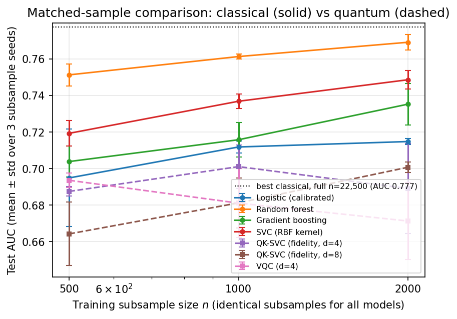

# quantum-credit-mqfs

**An honest three-way benchmark of classical vs quantum machine learning on
real credit-risk data, with finance-aware evaluation.**

Mediterranean Quantitative Finance Society (MQFS) working paper project —
Nicolò Angileri, 2026. MIT licence.

> **No quantum advantage is claimed.** At every training size a fidelity
> quantum kernel can currently reach, classical models match or beat the
> quantum models on this dataset — while training orders of magnitude faster.
> The contribution is the *protocol* and the *measured regime*: a
> reproducible, cost-honest, matched-sample baseline that future quantum
> claims on tabular credit risk can be checked against.

## What this repository does

1. **Data** — fetches and caches the UCI *Default of Credit Card Clients*
   dataset (30,000 real Taiwanese credit-card accounts, Yeh & Lien 2009;
   `data/` is gitignored, SHA-256 recorded in `results/data_manifest.json`),
   with a defensive, unit-tested parser. Every preprocessing decision is
   documented in [`docs/DATA_NOTES.md`](docs/DATA_NOTES.md).
2. **Part 1 (classical)** — calibrated logistic regression, random forest and
   histogram gradient boosting on the full training set: stratified split +
   5-fold CV, fixed seeds, explicit class-imbalance handling, AUC / PR-AUC /
   Brier / reliability diagrams, **cost-sensitive evaluation** (5:1
   expected-loss matrix with Bayes-optimal threshold t\* = 1/6, Elkan 2001)
   and **NT$ profit curves** using each client's actual credit limit as
   exposure, plus permutation feature importance.
3. **Part 2 (quantum, honest)** — fidelity quantum kernel (Qiskit
   ZZFeatureMap) + SVC and a small variational quantum classifier, on exact
   statevector simulation, with mutual-information feature reduction to
   d = 4/8 qubits. **Fairness rule:** the quantum kernel costs O(n²), so
   quantum models train on subsamples of 500/1000/2000 points — and every
   classical baseline is **re-trained on exactly the same subsamples**
   (3 seeds), evaluated on the same fixed 7,500-client test set.
   Quantum-on-2000 is never compared with classical-on-22,500. Wall-clock
   cost of every phase is reported honestly.
4. **Part 3 (paper + engineering)** — a LaTeX working paper built entirely
   from `results/*.json`, a pytest suite with known-answer tests (parser,
   metrics, cost-matrix algebra, kernel symmetry/PSD, VQC), ruff, CI, and a
   one-command pipeline that regenerates every number and figure.

## Results

*Every number below is auto-generated from actual runs (`results/*.json`)
by `experiments/render_tables.py`; CI-checkable with `--check-readme`.*

<!-- AUTO-TABLES:BEGIN (generated by experiments/render_tables.py — do not edit) -->

### Part 1 — classical models, full training set (n = 22,500; test n = 7,500)

| Model | CV AUC (5-fold) | Test AUC | Test PR-AUC | Test Brier | Cost @ t*OOF | Profit @ t*OOF (NT$ M) | Fit time (s) |
|---|---|---|---|---|---|---|---|
| Logistic regression (calibrated) | 0.7281 ± 0.0072 | 0.7189 | 0.4966 | 0.1424 | 0.6376 | 17.6 | 1.9 |
| Random forest | 0.7795 ± 0.0046 | 0.7721 | 0.5527 | 0.1495 | 0.5736 | 30.8 | 3.7 |
| Gradient boosting (HGB) | 0.7822 ± 0.0059 | 0.7774 | 0.5528 | 0.1792 | 0.5612 | 34.2 | 0.1 |

Cost matrix: missed default (FN) = 5, rejected good client (FP) = 1 (Bayes threshold t* = 0.167). Operating thresholds chosen on out-of-fold training predictions only.

### Part 2 — the honest table: identical subsamples, classical vs quantum

Test AUC, mean ± std over 3 stratified subsample draws; every model trained on the *same* subsamples, evaluated on the same fixed test set (n = 7,500).

| Model | n = 500 | n = 1000 | n = 2000 | Train+test time @ n=2000 |
|---|---|---|---|---|
| Logistic regression (calibrated) | 0.6949 ± 0.0267 | 0.7118 ± 0.0033 | 0.7148 ± 0.0017 | 0.0 s |
| Random forest | 0.7513 ± 0.0060 | 0.7613 ± 0.0013 | 0.7691 ± 0.0042 | 0.6 s |
| Gradient boosting (HGB) | 0.7038 ± 0.0085 | 0.7158 ± 0.0093 | 0.7352 ± 0.0114 | 0.3 s |
| SVC, RBF kernel (classical twin) | 0.7193 ± 0.0070 | 0.7368 ± 0.0038 | 0.7486 ± 0.0051 | 1.5 s |
| **QK-SVC, fidelity kernel, d=4** | 0.6875 ± 0.0026 | 0.7011 ± 0.0119 | 0.6891 ± 0.0247 | 7.2 s |
| **QK-SVC, fidelity kernel, d=8** | 0.6643 ± 0.0173 | 0.6812 ± 0.0137 | 0.7007 ± 0.0029 | 28.4 s |
| **VQC, d=4** | 0.6936 ± 0.0040 | 0.6811 ± 0.0189 | 0.6713 ± 0.0210 | 7.1 s |

### Part 2b — expected cost per applicant at the fixed Bayes threshold (t* = 0.167, lower is better)

| Model | n = 500 | n = 1000 | n = 2000 |
|---|---|---|---|
| Logistic regression (calibrated) | 0.6862 ± 0.0286 | 0.6960 ± 0.0102 | 0.6871 ± 0.0100 |
| Random forest | 0.6685 ± 0.0115 | 0.6516 ± 0.0090 | 0.6389 ± 0.0204 |
| Gradient boosting (HGB) | 0.7300 ± 0.0254 | 0.6948 ± 0.0120 | 0.6386 ± 0.0176 |
| SVC, RBF kernel (classical twin) | 0.6402 ± 0.0117 | 0.6251 ± 0.0107 | 0.6007 ± 0.0151 |
| **QK-SVC, fidelity kernel, d=4** | 0.6670 ± 0.0193 | 0.6321 ± 0.0081 | 0.6288 ± 0.0150 |
| **QK-SVC, fidelity kernel, d=8** | 0.7060 ± 0.0327 | 0.6732 ± 0.0067 | 0.6574 ± 0.0062 |
| **VQC, d=4** | 0.7788 ± 0.0000 | 0.7787 ± 0.0001 | 0.7796 ± 0.0015 |

<!-- AUTO-TABLES:END -->



**Conclusion.** Classical machine learning wins at every matched sample size
in this study, and does so at a small fraction of the computational cost. No
quantum advantage is claimed — or observed — in this regime. That is the
expected result at this scale, and reporting it plainly is the point: this
repository is the ruler, not the record.

## Reproduce everything

```bash
uv venv --python 3.12 && source .venv/bin/activate
uv sync                          # or: uv pip install -e . --group dev
python -m quantum_credit.data    # fetch + validate the dataset (cached)
python experiments/run_all.py    # all experiments + figures + README tables
python paper/build_paper.py      # LaTeX if available, otherwise fpdf2
pytest                           # unit tests (offline); integration tests
                                 # activate automatically once data is cached
```

The full pipeline is designed to finish in **well under 30 minutes on a
laptop** (measured time in `results/run_metadata.json`). Results in this
repository were produced on Python 3.10 (build-sandbox constraint; the
project targets ≥3.10 and CI runs 3.12) — exact versions in
`results/run_metadata.json`.

### Optional: real-QPU kernel check

```bash
uv pip install -e ".[hardware]"
python experiments/run_hardware.py --hardware --n 6
```

Estimates one tiny Gram sub-block (≤28 compute–uncompute circuits, one job,
Open-plan friendly) on the least-busy IBM backend and compares measured vs
simulated kernel entries. Credentials are read **only** from your saved
`QiskitRuntimeService` account (`~/.qiskit`); **tokens never enter this
repository** (and `.gitignore` enforces it). Not executed for the committed
results — the build environment holds no credentials.

## Repository layout

```
src/quantum_credit/        # small pure functions, type hints
  data.py                  # cached fetch + defensive parser
  features.py              # MI/PCA reduction to angles in [0, π]
  models.py costs.py       # classical factories; cost/profit math
  metrics.py subsample.py
  quantum/                 # featuremap, fidelity kernel, VQC, hardware
tests/                     # known-answer + property tests (offline)
experiments/               # regenerate every number & figure
results/ figures/          # committed run outputs (JSON + PNG)
paper/                     # LaTeX working paper + fpdf2 fallback
docs/DATA_NOTES.md         # every preprocessing decision
```

## Citations

Dataset: I-C. Yeh & C-H. Lien (2009), *Expert Systems with Applications*
36(2), via the UCI ML Repository (id 350). Quantum kernels: Havlíček et al.
(2019), *Nature* 567; Schuld & Killoran (2019), *PRL* 122. Cost-sensitive
learning: Elkan (2001), IJCAI. Credit-scoring benchmarks: Lessmann et al.
(2015), *EJOR* 247. Full list in the working paper.

---

Built with AI-assisted engineering; every design decision, formula and
validation reviewed and owned by the author.
